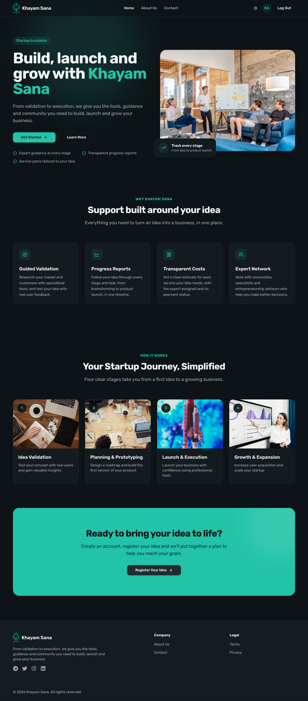

# Khayam Sana

Khayam Sana is a web platform for a startup incubator. Founders register their business ideas, and the incubator team turns each idea into a tracked plan: a progress report broken into stages and tasks, and a cost estimate for the services the idea needs.

**Live site:** https://sana-client.vercel.app/



## What it does

**For founders**

- **Sign up and log in** with email and password.
- **Register ideas** from the *My Ideas* page: title, description, field of study, location and contact details.
- **Get a progress report for every idea.** Each new idea gets a report automatically. Its report ID is shown on the idea card with a copy button.
- **Follow progress** on *My Reports*: enter a report ID to see the timeline. It covers four stages (Idea Evaluation, Prototype Development, Testing, Development and Deployment), the tasks in each stage, their status, and an overall completion percentage. Clicking a task opens it to update its status and notes.
- **See cost estimates** on *My Costs*: the services recommended for the idea, their price (in Toman), the assigned expert and whether each one is paid.
- **Manage your profile**: edit your details or delete your account along with its ideas and reports.

**For admins**

- See all users and their details, ideas and reports.
- Create and edit cost estimates for a user's idea, and mark services as paid.

The site has light and dark themes and works on phones.

## Tech stack

| Part   | Technology |
| ------ | ---------- |
| Client | Next.js 14 (App Router), React 18, TypeScript, Tailwind CSS, shadcn/ui (Radix UI), react-hook-form |
| Server | Node.js, Express 4, Mongoose 8, JSON Web Tokens, bcryptjs |
| Database | MongoDB (MongoDB Atlas) |
| Hosting | Vercel (client and API) |

## Project structure

```
sana/
├── client/                 Next.js front end
│   └── src/
│       ├── app/            Pages (home, about, contact, auth, dashboard)
│       ├── components/     UI components (shadcn/ui in components/ui)
│       ├── context/        Auth context
│       ├── hooks/          HTTP request hook
│       └── types/          Shared TypeScript types
├── server/                 Express API
│   ├── index.js            App entry: routes, CORS, database connection
│   ├── scripts/            One-off maintenance scripts
│   └── src/
│       ├── controllers/    Request handlers
│       ├── middleware/     Auth and admin checks
│       ├── models/         Mongoose schemas (user, idea, report, cost)
│       └── routes/         API routes
└── docs/                   Images used in this README
```

## Getting started

You need Node.js 20.6 or later and a MongoDB database (a free MongoDB Atlas cluster works).

### 1. Start the API

```bash
cd server
npm install
```

Create `server/.env`:

```
DB_USER=your-atlas-user
DB_PASSWORD=your-atlas-password
SUFFIX=cluster0            # from cluster0.xxxxx.mongodb.net
AFTER_SUFFIX=xxxxx
DB_NAME=sana
APP_NAME=your-app-name
JWT_SECRET=a-long-random-string

# Optional: use a full connection string instead (e.g. a local database)
# MONGODB_URI=mongodb://localhost:27017/sana
```

Then run it:

```bash
npm run dev
```

The API runs on http://localhost:5000. If it can't connect to Atlas, add your IP under *Network Access* in Atlas.

### 2. Start the client

```bash
cd client
npm install
npm run dev
```

The site runs on http://localhost:3000. It reads the API address from `NEXT_PUBLIC_API_URL`, which is set to `http://localhost:5000/api` in `client/.env.development`.

### Making a user an admin

New accounts are regular users. To make one an admin, set its `role` field to `admin` in the `users` collection.

## API overview

All routes are under `/api`.

| Resource | Endpoints |
| -------- | --------- |
| Users | `POST /users/signup`, `POST /users/login`, `GET /users` (admin), `GET /users/:uid`, `PATCH /users/:uid`, `PATCH /users/:uid/role` (admin), `DELETE /users/:uid` |
| Ideas | `POST /ideas` (also creates the idea's report), `GET /ideas/:eid`, `GET /ideas/user/:uid`, `PATCH /ideas/:eid`, `DELETE /ideas/:eid` |
| Reports | `POST /reports`, `GET /reports/:rid`, `PATCH /reports/:rid` |
| Costs | `POST /costs`, `GET /costs/:cid`, `GET /costs/user/:uid`, `PATCH /costs/:cid` |

## Scripts

| Location | Command | What it does |
| -------- | ------- | ------------ |
| `client` | `npm run dev` | Start the Next.js dev server |
| `client` | `npm run build` / `npm start` | Build and serve the production site |
| `client` | `npm run lint` | Lint the client |
| `server` | `npm run dev` | Start the API with auto-reload, loading `server/.env` |
| `server` | `node --env-file=.env scripts/migrate-to-english.js` | One-off: convert Persian values stored by older versions to English |
